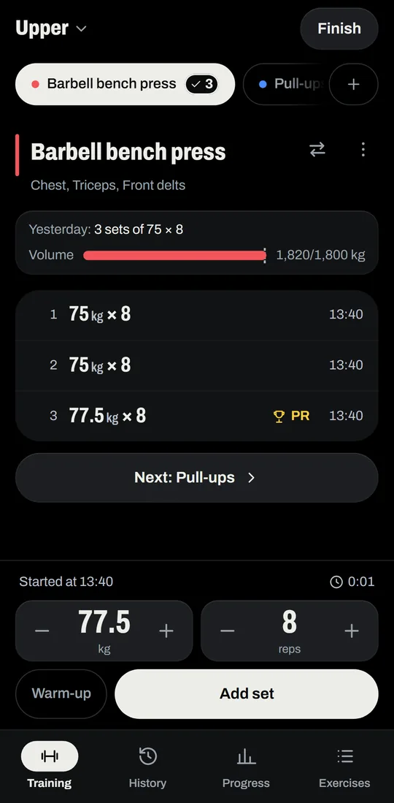
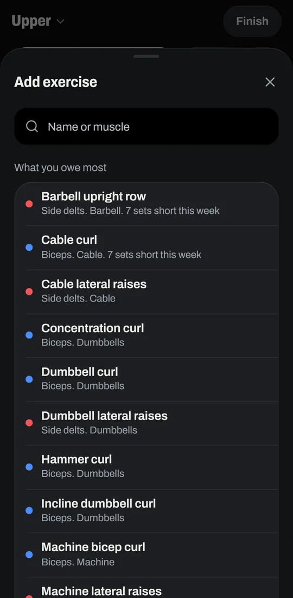
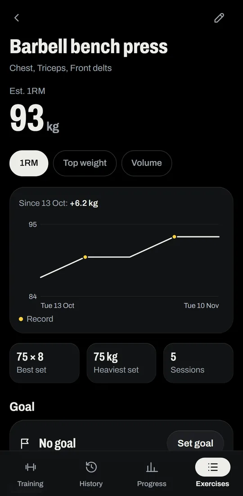

# SetRack

SetRack is a gym log for Android that keeps your sets and progress on your phone, with no account.

- Google Play: https://play.google.com/store/apps/details?id=com.setrack.app
- Website: https://iggykimi.github.io/setrack-web/

  
  
  

## What makes it different

The app does not declare the `INTERNET` permission. Its only Android permission is `VIBRATE`, for the tick when you log a set. A script in the app repo checks this against the merged release manifest.

Your data lives in the phone's local storage. You can save a backup file to Downloads, restore it from there, and export everything to CSV. The backup is a documented JSON file, so another tool can read it; the app does not import CSV from other apps.

It is free. There are no ads, no subscription and no analytics.

It suggests exercises by the sets each muscle still needs this week. A primary muscle counts a full set and a secondary one counts half. Estimated 1RM uses the Brzycki formula, and sets above 12 reps are left out because the formula overestimates there.

It ships with 104 built-in exercises and three starter programs, and you can add your own exercises. The interface is in 11 languages, in kilos or pounds.

## How it is built

The app is an offline-first PWA wrapped as a native Android app with Capacitor 8. It uses React 19, TypeScript, Vite and Dexie on IndexedDB. Its code is in a private repository.

The last full run before release 1.0.9 (11 November 2026) passed 271 unit and integration tests (Vitest) and 186 end-to-end tests (Playwright on a mobile Chromium profile). Release 1.0.11 (13 November 2026) shipped with the same suite green on CI.

ESLint rejects any function with cyclomatic complexity above 6, more than 40 lines or more than 3 parameters. CI runs it on every push to `master`, with the type check, both test suites and an unused-code check (knip). The end-to-end suite includes detectors for text that overflows, gets cut or overlaps. They run the app in all 11 languages at 360 and 300 px wide; 300 px stands in for a large system font.

SetRack is developed with AI coding agents. They work under a written `CLAUDE.md` that I maintain, with the architecture, the formulas, the data schema and the quality rules above.

## This repository

This is the source of the website. It is static HTML with no JavaScript and no external requests.

- `index.html` and `en/`, `pt/`, `de/`, `fr/`, `it/`, `pl/`, `nl/`, `ja/`, `ko/`, `zh-tw/` hold the home page in 11 languages. Spanish is at the root.
- Each language has a privacy policy page, for example `privacidad/` and `en/privacy/`. The home page also carries the full policy, because `/` is the URL registered in Google Play.
- `build/texts.mjs` holds all the text, `build/build.mjs` writes the 22 pages and `sitemap.xml`, and `build/check.mjs` validates them. Run `node build/build.mjs && node build/check.mjs` from the repo root and commit the output. Do not edit the generated `index.html` files by hand.
- `assets/` has the stylesheet, the icon, the app screenshots per language (`assets/img/`) and the Open Graph images.
- `fonts/` has Archivo, self-hosted, with its OFL license.
- `DESIGN.md` records the design direction and the claims the site may make.
- `docs/` has the screenshots used in this README.

GitHub Pages serves the `main` branch from the root. There is no build step on GitHub: a push to `main` publishes the committed files.

Bugs and questions: https://github.com/iggykimi/setrack-web/issues
